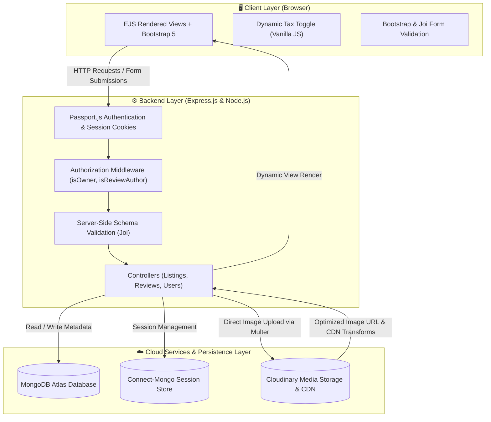
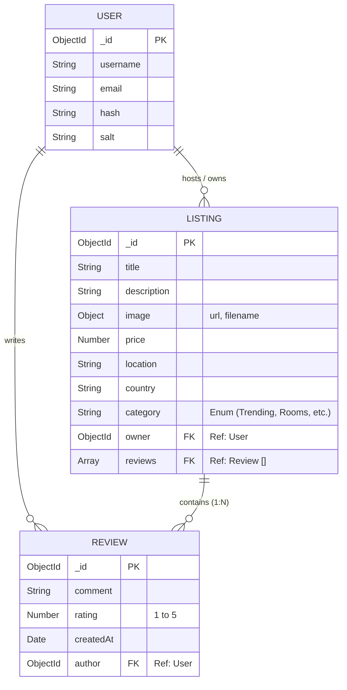

<div align="center">

# 🏡 WanderLust

### *Full-Stack Vacation Rental & Hospitality Platform*

[](https://nodejs.org/)
[](https://expressjs.com/)
[](https://www.mongodb.com/atlas)
[](https://cloudinary.com/)
[](https://getbootstrap.com/)
[](https://www.passportjs.org/)
[](https://opensource.org/licenses/ISC)

<br/>

**[🌐 Live Demo](https://wanderlust-travel.onrender.com)**

*(Note: If the live demo URL differs or is hosted on a specific platform like Render/Vercel, update the Live Demo link above).*

<br/>

</div>

---

## 📖 Table of Contents

- [Overview](#-overview)
- [System Architecture](#-system-architecture)
- [Key Features](#-key-features)
- [Tech Stack](#-tech-stack)
- [Database Schema & Data Models](#-database-schema--data-models)
- [API & Route Specifications](#-api--route-specifications)
- [Security & Validation Engineering](#-security--validation-engineering)
- [Project Directory Structure](#-project-directory-structure)
- [Getting Started & Local Setup](#-getting-started--local-setup)
- [Environment Configuration](#-environment-configuration)
- [Technical Decisions & Trade-Offs](#-technical-decisions--trade-offs)
- [Roadmap & Future Enhancements](#-roadmap--future-enhancements)
- [Author & Acknowledgments](#-author--acknowledgments)

---

## 🌟 Overview

**WanderLust** is a production-grade, full-stack vacation rental marketplace built with the Node.js/Express ecosystem and MongoDB Atlas. Inspired by Airbnb, WanderLust bridges the gap between property hosts and travelers, providing an intuitive, secure, and responsive platform for listing, discovering, and reviewing unique accommodations worldwide.

### 🎯 Problem Statement & Solution
- **The Challenge:** Traditional travel accommodation apps often require complex client-side bundles and monolithic setups, slowing down load times on low-bandwidth networks and introducing security vulnerabilities around authentication, image uploading, and authorization.
- **The WanderLust Solution:** Built with an optimized **Model-View-Controller (MVC)** server-side rendering architecture utilizing **EJS-Mate**, **MongoDB Atlas cloud clustering**, **Cloudinary cloud media storage**, and **Passport.js** session management. This ensures rapid initial page loads, rock-solid authorization boundaries, and seamless media optimization out of the box.

---

## 🏗 System Architecture

WanderLust follows a strict **Model-View-Controller (MVC)** architectural pattern, separating data models, route handlers/controllers, and presentation templates.



---

## ✨ Key Features

### 🏡 1. Accommodation Discovery & Category Filtering
- **Multi-Category Navigation:** Filter destinations effortlessly across diverse categories including *Trending, Rooms, Iconic Cities, Mountains, Castles, Amazing Pools, Camping, Farms, Arctic, Domes, and Boats*.
- **Interactive Price & GST Switch:** Dynamic client-side tax switch automatically calculates and toggles the standard 18% GST display without requiring page refreshes.
- **Search Experience:** Navbar search bar allowing travelers to quickly query properties by title, region, or city.

### 📸 2. Cloud Media Pipeline & Listing Management (CRUD)
- **Direct Cloud Uploads:** Integrated **Multer** and **Cloudinary Storage Engine** for image asset uploads during listing creation and updates.
- **On-the-Fly Image Transformations:** Utilizes Cloudinary's dynamic URL manipulation (`/upload/w_250`) to generate optimized preview thumbnails for editing forms, cutting payload size and saving bandwidth.
- **Full Host Lifecycle:** Registered users can create, read, update, and delete property listings with automated field validation.

### ⭐ 3. Interactive Review & Rating Engine
- **Starability Visual Rating:** Implemented an accessible 5-star rating widget using pure CSS micro-interactions.
- **Cascading Deletions:** Custom Mongoose post-hook middleware (`findOneAndDelete`) automatically triggers cascading deletion of all associated reviews whenever a listing is removed, preventing orphaned documents in MongoDB.

### 🛡️ 4. Enterprise-Grade Authentication & Authorization
- **Hashed & Salted Credentials:** Powered by `passport-local-mongoose` with automated PBKDF2 hashing and salting.
- **Granular RBAC (Role-Based Access Control):** Custom middleware locks down sensitive operations:
  - `isLoggedIn`: Guarantees protected routes are only accessible to authenticated users.
  - `isOwner`: Restricts listing edit and delete controls solely to the listing creator.
  - `isReviewAuthor`: Restricts review deletion permissions to the original reviewer.
- **Smart Session Redirection:** Preserves the user's intended target URL across login redirects for frictionless UX.

### ⚡ 5. Production Reliability & Resilient Sessions
- **Atlas-Backed Session Store:** Implements `connect-mongo` session caching with a 24-hour lazy touch cycle (`touchAfter: 24 * 3600`) to minimize unneeded database writes while keeping users securely logged in for up to 7 days.
- **Centralized Error Handling:** Custom `ExpressError` class coupled with an asynchronous handler wrapper (`wrapAsync`) catches uncaught promises and gracefully renders user-friendly error views.

---

## 🛠 Tech Stack

| Domain | Technology | Purpose |
| :--- | :--- | :--- |
| **Runtime & Framework** | `Node.js (v24)`, `Express.js (v5)` | High-performance asynchronous backend server |
| **Database & ODM** | `MongoDB Atlas`, `Mongoose (v9)` | Cloud NoSQL document database & structured schema modeling |
| **Session Persistence** | `connect-mongo`, `express-session` | Production-ready, distributed cloud session storage |
| **Authentication** | `Passport.js`, `passport-local`, `passport-local-mongoose` | Secure local credential authentication & session serialization |
| **View Engine & Layouts** | `EJS`, `ejs-mate` | Server-side templating with modular layouts and partials |
| **Validation** | `Joi` (Backend), `Bootstrap 5` (Frontend) | Dual-layer schema constraint validation |
| **File Handling & Cloud** | `Multer`, `Cloudinary`, `multer-storage-cloudinary` | Multi-part form parsing & CDN media delivery |
| **UI Styling & Assets** | `Bootstrap 5.3`, `FontAwesome 7`, `Starability CSS` | Clean responsive layout, iconography, and interactive rating slots |


---

## 🗄 Database Schema & Data Models

WanderLust uses a relational document approach inside MongoDB with normalized references:



---

## 🔌 API & Route Specifications

### Listing Routes (`/listings`)

| Method | Endpoint | Handler Action | Access / Protection |
| :--- | :--- | :--- | :--- |
| `GET` | `/listings` | Fetches listings (supports category filter `?filter=Trending`) | Public |
| `GET` | `/listings/new` | Renders property creation form | Authenticated (`isLoggedIn`) |
| `POST` | `/listings` | Uploads image to Cloudinary, validates body & creates listing | Authenticated (`isLoggedIn`, `validateListing`) |
| `GET` | `/listings/:id` | Populates and displays listing with reviews and host details | Public |
| `GET` | `/listings/:id/edit` | Renders edit form with 250px Cloudinary preview transformation | Authorized (`isLoggedIn`, `isOwner`) |
| `PUT` | `/listings/:id` | Updates listing attributes & re-uploads image if modified | Authorized (`isLoggedIn`, `isOwner`, `validateListing`) |
| `DELETE`| `/listings/:id` | Cascades review deletion and removes listing | Authorized (`isLoggedIn`, `isOwner`) |

### Review Routes (`/listings/:id/reviews`)

| Method | Endpoint | Handler Action | Access / Protection |
| :--- | :--- | :--- | :--- |
| `POST` | `/listings/:id/reviews` | Attaches validated review to property and author | Authenticated (`isLoggedIn`, `validateReview`) |
| `DELETE`| `/listings/:id/reviews/:reviewId` | De-references and deletes review document | Authorized (`isLoggedIn`, `isReviewAuthor`) |

### Authentication Routes (`/`)

| Method | Endpoint | Handler Action | Access / Protection |
| :--- | :--- | :--- | :--- |
| `GET` | `/signup` | Renders registration form | Public |
| `POST` | `/signup` | Registers new user and invokes automated login | Public |
| `GET` | `/login` | Renders user login interface | Public |
| `POST` | `/login` | Authenticates credentials and redirects to intended URL | Public (Passport Local Strategy) |
| `GET` | `/logout` | Destroys session and flashes status notification | Authenticated |

---

## 🔒 Security & Validation Engineering

- **Dual-Layer Validation:**
  - **Client-Side:** HTML5 and Bootstrap `needs-validation` provide instant visual feedback on missing fields.
  - **Server-Side:** Strict **Joi Schemas** (`listingSchema`, `reviewSchema`) validate incoming requests at the API boundary, protecting the database from corrupted payloads or bypassed frontends.
- **Resource Ownership Guards:** Database operations are locked down using custom middleware verifying that `req.user._id` matches the document's `owner` or `author` before allowing state-mutating requests (`PUT`, `DELETE`).
- **Session Hardening:** Configured with `httpOnly: true` to prevent Cross-Site Scripting (XSS) attacks on cookies, with strict expiration rules (`maxAge: 7 days`).
- **Sanitized Secrets:** No hardcoded credentials exist in source control; all sensitive tokens are managed via environment variables and ignored by `.gitignore`.

---

## 📂 Project Directory Structure

```text
Airbnb_replica/
├── controllers/          # Business logic handlers
│   ├── listings.js       # Listing CRUD operations & image handling
│   ├── reviews.js        # Review submission & cascading deletion
│   └── users.js          # User registration, authentication & logout
├── init/                 # Database seeding utilities
│   ├── data.js           # Sample dataset with categories & geo-locations
│   └── index.js          # Seeder script populating MongoDB Atlas
├── models/               # Mongoose schemas & data relationships
│   ├── listing.js        # Listing model with cascade middleware
│   ├── review.js         # Review schema with author relationship
│   └── user.js           # User schema configured with passport-local-mongoose
├── public/               # Static client assets
│   ├── CSS/              # Custom stylesheets (style.css, rating.css)
│   └── js/               # Client-side scripts (script.js)
├── routes/               # Express modular route definitions
│   ├── listing.js        # Route chaining for /listings
│   ├── review.js         # Nested route handlers for reviews
│   └── user.js           # Auth routes (/signup, /login, /logout)
├── utils/                # Helper utilities
│   ├── ExpressError.js   # Custom HTTP error class
│   └── wrapAsync.js      # Async exception wrapper
├── views/                # EJS server-rendered templates
│   ├── includes/         # Reusable partials (navbar, footer, flash)
│   ├── layouts/          # Boilerplate layout (boilerplate.ejs)
│   ├── listings/         # Listing views (index, new, show, edit)
│   └── users/            # Auth views (login, signup)
├── CloudConfig.js        # Cloudinary SDK & Multer storage configuration
├── middleware.js         # Auth checks, ownership verification & Joi validators
├── schema.js             # Joi validation schemas
├── app.js                # Application entrypoint & middleware pipeline
├── package.json          # Dependencies & execution scripts
├── .env.example          # Template for required environment variables
└── README.md             # Project documentation
```

---

## 🚀 Getting Started & Local Setup

### Prerequisites
Make sure you have the following installed on your machine:
- **Node.js**: `v18.x` or higher (tested on `v24.x`)
- **npm**: `v9.x` or higher
- **MongoDB Atlas** account (or local MongoDB daemon)
- **Cloudinary** account (free tier works great)

### Step-by-Step Installation

1. **Clone the repository:**
   ```bash
   git clone https://github.com/Nikitak1012/WanderLust.git
   cd WanderLust
   ```

2. **Install project dependencies:**
   ```bash
   npm install
   ```

3. **Configure Environment Variables:**
   Duplicate the provided `.env.example` file to create your own `.env`:
   ```bash
   cp .env.example .env
   ```
   Open `.env` and fill in your Cloudinary keys and MongoDB Atlas connection string.

4. **Seed the Database (Optional but Recommended):**
   Populate your MongoDB database with pre-configured destination listings:
   ```bash
   node init/index.js
   ```

5. **Launch the Application:**
   ```bash
   node app.js
   ```
   *Or with nodemon for active development:*
   ```bash
   npx nodemon app.js
   ```

6. **Access WanderLust:**
   Open your browser and navigate to:
   ```text
   http://localhost:8080
   ```

---

## ⚙️ Environment Configuration

Create a `.env` file in the root directory and define the following variables:

| Variable | Description | Required | Example Placeholder |
| :--- | :--- | :---: | :--- |
| `PORT` | Local port for Express server | No (default: `8080`) | `8080` |
| `NODE_ENV` | Runtime environment mode | No | `development` / `production` |
| `ATLASDB_URL` | MongoDB Atlas cluster connection URI | **Yes** | `mongodb+srv://<user>:<password>@cluster.mongodb.net/wanderlust` |
| `SECRET` | Encryption secret for sessions & cookies | **Yes** | `my_super_secret_session_key` |
| `CLOUD_NAME` | Cloudinary account cloud identifier | **Yes** | `your_cloud_name` |
| `CLOUD_API_KEY` | Cloudinary REST API key | **Yes** | `123456789012345` |
| `CLOUD_API_SECRET` | Cloudinary REST API secret | **Yes** | `your_api_secret_hash` |

---

## 💡 Technical Decisions & Trade-Offs

- **Server-Side Rendering (SSR) via EJS vs. Single Page App (SPA):**
  - *Decision:* Chose EJS with `ejs-mate` layouts instead of React/Next.js.
  - *Rationale:* Eliminates complex build pipelines and hefty JavaScript bundles, delivering SEO-friendly HTML and sub-second First Contentful Paint (FCP) on mobile networks.
- **Direct Cloud CDN Storage vs. Local Disk Storage:**
  - *Decision:* Implemented `multer-storage-cloudinary` for instant remote media uploads.
  - *Rationale:* Modern deployment platforms (e.g., Render, Heroku) use ephemeral file systems where local files are wiped upon dyno restarts. Cloudinary ensures permanent, scalable, and globally accelerated media delivery.
- **Relational Referencing with Mongoose Cascades:**
  - *Decision:* Maintained a 1-to-many relationship where Listings store an array of Review ObjectIds, paired with a `findOneAndDelete` post-hook.
  - *Rationale:* Keeps individual listing document sizes within MongoDB's 16MB limit while ensuring complete cleanup of orphaned child reviews.

---

## 🗺 Roadmap & Future Enhancements

- [ ] **Interactive Map Integration:** Integrate Mapbox or Leaflet.js to pinpoint listing coordinates dynamically on an interactive map.
- [ ] **Real-Time Booking & Reservations:** Add check-in / check-out calendar picker with date conflict detection.
- [ ] **Stripe / Razorpay Checkout:** Integrate payment gateways to support end-to-end booking reservations.
- [ ] **Full-Text Elastic / Mongo Search:** Enhance navbar search with autocomplete and filter parameters (price range, guest count, amenities).
- [ ] **OAuth 2.0 Social Logins:** Support "Continue with Google" and "Continue with GitHub" via Passport strategies.

---

## 👤 Author & Acknowledgments

**Nikita Kumawat**
- **GitHub:** [@Nikitak1012](https://github.com/Nikitak1012)
- **Repository:** [Nikitak1012/WanderLust](https://github.com/Nikitak1012/WanderLust)

### 📄 License
This project is licensed under the [ISC License](file:///c:/Users/user/OneDrive/Desktop/wbfolder/Airbnb_replica/package.json#L14).
